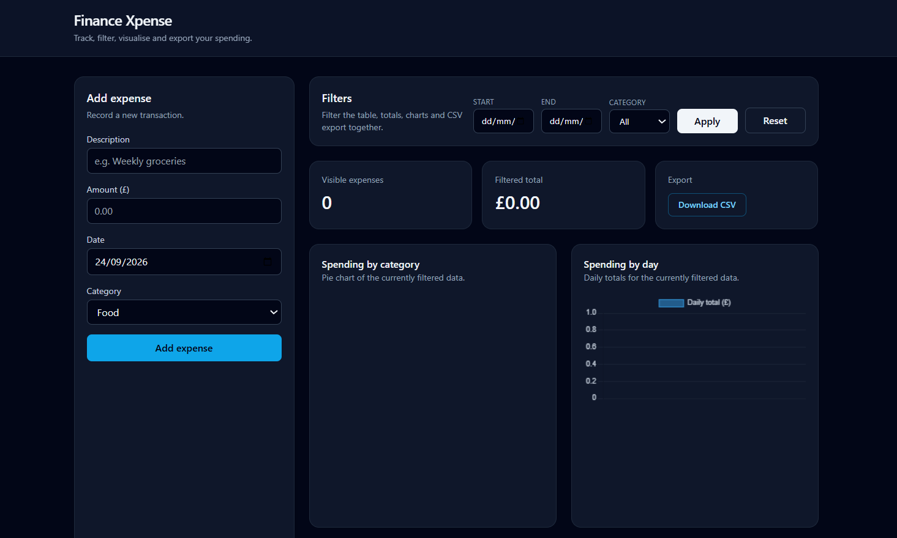
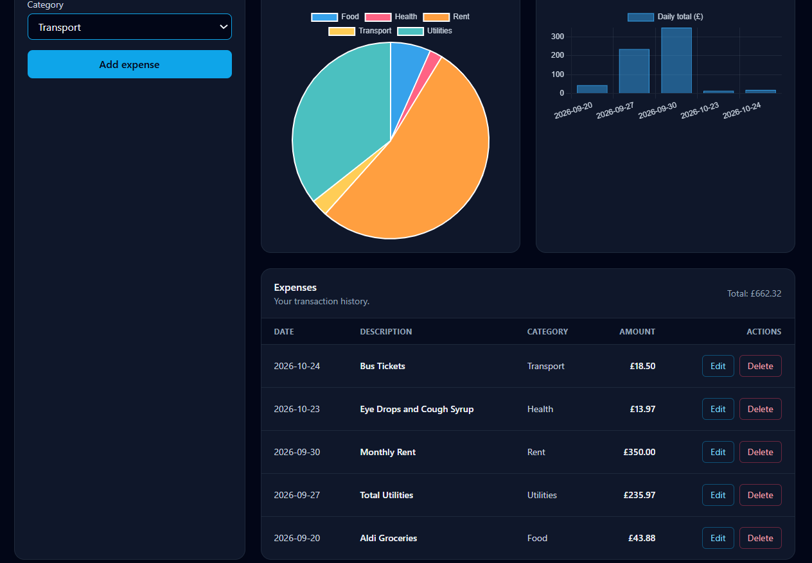
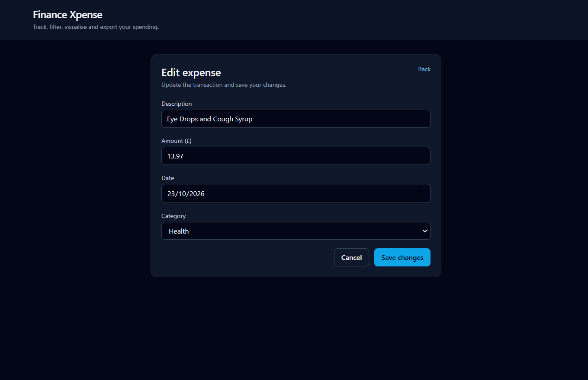

# Xpense

Xpense is a personal expense tracker I built with Flask. It lets you record expenses, filter spending by date or category, view totals and charts, edit existing entries and export the current view to CSV.

**Python · Flask · SQLAlchemy · SQLite · Chart.js · Jinja**

## Screenshots

### Dashboard



### Spending charts and transaction history



### Edit expense



## Main features

- add, edit and delete expenses
- store description, amount, category and date in SQLite
- filter expenses by date range and category
- calculate totals for the current filtered view
- visualise spending by category and by day
- export filtered expenses to CSV
- validate form input on the server
- display success and error messages after actions

## How it works

The application uses Flask for the routes and request handling, with Flask-SQLAlchemy for storing expenses in a SQLite database.

The same filters are applied to the expense table, totals, chart queries and CSV export so the different parts of the dashboard stay consistent with the selected view.

Chart.js is used to display spending by category and daily spending, while the interface is rendered with Jinja templates.

## Technologies

- Python
- Flask
- Flask-SQLAlchemy / SQLAlchemy
- SQLite
- Jinja
- Chart.js
- Tailwind CSS via CDN

## Getting started

Create a virtual environment and install the dependencies:

```bash
python -m venv .venv
```

On macOS/Linux:

```bash
source .venv/bin/activate
pip install -r requirements.txt
python app.py
```

On Windows PowerShell:

```powershell
.\.venv\Scripts\Activate.ps1
pip install -r requirements.txt
python app.py
```

Then open:

```text
http://127.0.0.1:5000
```

The database is created automatically at `instance/expenses.db`.

## Project structure

```text
app.py             Flask routes, validation, model and queries
templates/         Jinja templates for the dashboard and edit form
testing/           Manual test plan and representative test data
requirements.txt   Python dependencies
screenshots/       README screenshots
```

## Testing

Xpense now has both manual and automated testing.

`testing/11_test_plan.md` contains a manual test plan covering start-up, validation, filtering, editing, deletion, CSV export and decimal currency behaviour.

`testing/10_seed_test_data.py` contains representative data and expected totals for checking those cases.

`tests/test_validation.py` contains automated `unittest` tests for:

- valid and invalid date parsing
- missing required expense fields
- invalid categories
- non-numeric, zero and negative amounts
- invalid dates
- reversed date filters
- unknown category filters

The automated validation tests are run on every push and pull request through GitHub Actions.

### AI-assisted testing exercise

I used ChatGPT to propose a small set of automated tests for Xpense's existing input-validation logic, then reviewed the suggestions against the application before adding them.

I rejected or changed suggestions that did not match the program's actual behaviour. For example, a blank date is valid in Xpense because the application defaults it to today's date, so I did not add a test that incorrectly expected a blank date to be rejected. I also kept this first automated suite focused on validation rather than mixing it with database-write tests.

The final validation suite runs successfully in GitHub Actions.

## What I built

I built the Flask routes, SQLAlchemy expense model, validation, CRUD operations, filtering, chart data, CSV export and Jinja-based interface.

## Possible next steps

- add automated tests
- add CSRF protection
- add pagination if the amount of stored data grows
